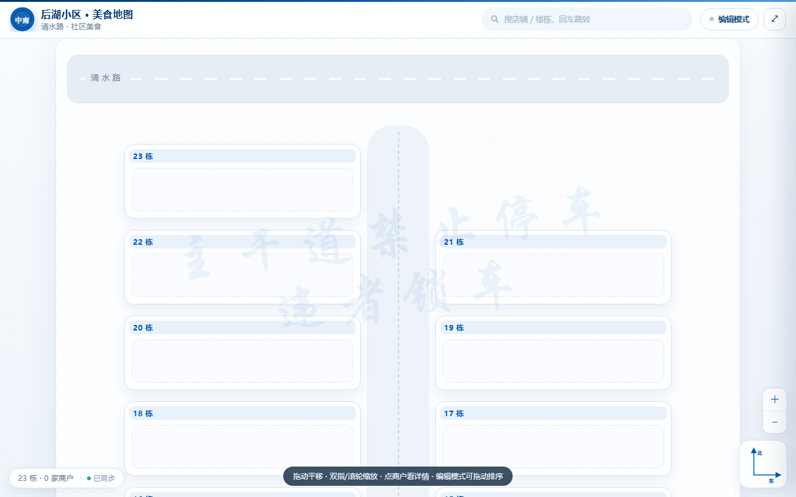
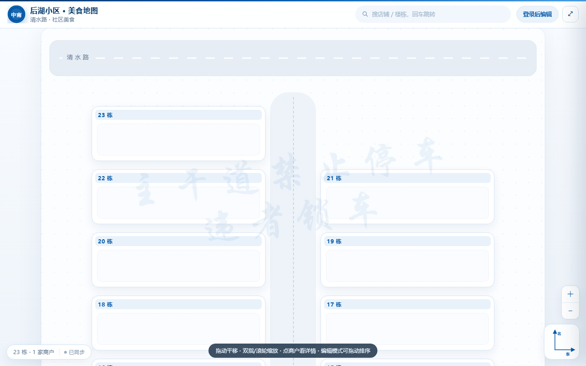
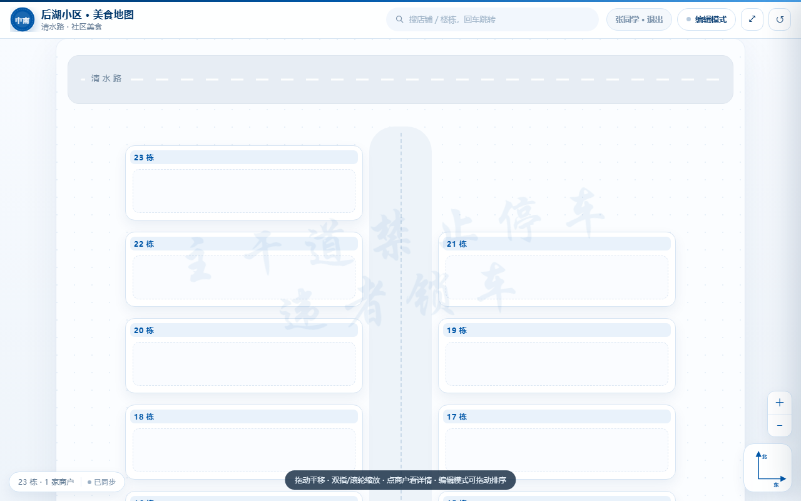

# 部署说明（多端同步服务器）

这个版本把地图托管成站点，**同一份数据多台设备共用**，改动实时推送。

## 权限模式：默认完全开放

默认 `REQUIRE_LOGIN=0`：**任何能打开网址的人都可以浏览和编辑**，不需要注册登录。
适合班级 / 宿舍 / 小范围内部使用。

如果以后想收紧（比如放到公网），把它改成 `REQUIRE_LOGIN=1`，
就会启用下面这套登录体系：

| 方式 | 用途 | 开启方式 |
|---|---|---|
| 本地账号 | 学校统一认证还没批下来时的过渡方案 | `ALLOW_LOCAL_LOGIN=1` |
| CAS 统一身份认证 | 对接中南大学信息门户 | 配置 `CAS_BASE_URL` |

默认（开放）打开的样子——没有登录入口，谁都能直接编辑：



> 页面没有「清空」按钮，任何人都无法一键清空整张地图。
> 需要清空时：停服务后删除 `data/map.json` 再启动；历史版本仍保留在 `data/history.json`，
> 想找回可以临时设 `REQUIRE_LOGIN=1`，用管理员登录后在 `/admin` 回滚。

开启 `REQUIRE_LOGIN=1` 后，访客只读，登录后右上角显示自己的名字：

| 未登录 | 登录后 |
|---|---|
|  |  |

---

## 一、准备

- 一台能跑 Node 18+ 的服务器（校内虚拟机、实验室小主机都行）
- 一个域名 + HTTPS 证书（登录 Cookie 在 https 下才会带 `Secure`）
- 端口 8080 给 Node，443 给 nginx

## 二、用 Docker 跑（推荐）

```bash
cd houhu-food-map
cp deploy/.env.example .env
vi .env                     # 至少改 BASE_URL、ADMIN_PASS

docker compose up -d --build
docker compose logs -f      # 首次启动会打印初始管理员密码
```

数据落在宿主机的 `./data/`，删容器不会丢。

## 三、不用 Docker（systemd）

```bash
# 服务器上
mkdir -p /srv/food-map && cd /srv/food-map
# 把 index.html style.css app.js server-auth.js 传上来
cp deploy/.env.example .env && vi .env

node server-auth.js          # 先手动跑一次，确认能起来
```

`/etc/systemd/system/food-map.service`：

```ini
[Unit]
Description=Houhu Food Map
After=network.target

[Service]
Type=simple
WorkingDirectory=/srv/food-map
EnvironmentFile=/srv/food-map/.env
ExecStart=/usr/bin/node /srv/food-map/server-auth.js
Restart=always
User=www-data

[Install]
WantedBy=multi-user.target
```

```bash
systemctl enable --now food-map
```

## 四、环境变量

| 变量 | 说明 |
|---|---|
| `PORT` | 监听端口，默认 8080 |
| `REQUIRE_LOGIN` | **默认 0：任何人可编辑**；设为 1 才需要登录 |
| `BASE_URL` | 对外地址，如 `https://food.example.edu.cn`；用于生成 CAS 回调和判断 Secure Cookie |
| `DATA_DIR` | 数据目录，默认 `./data` |
| `ADMIN_USER` / `ADMIN_NAME` | 初始管理员账号名 / 显示名（仅首次启动生效） |
| `ADMIN_PASS` | 初始管理员密码；留空则随机生成并打印在日志里 |
| `ALLOW_LOCAL_LOGIN` | 是否允许本地账号登录，默认 `1`；纯 CAS 部署可设 `0` |
| `CAS_BASE_URL` | CAS 服务地址；留空关闭，填 `mock` 用内置模拟门户 |
| `CAS_SERVICE` | 回调地址，默认 `BASE_URL + /auth/cas/callback`，必须与学校登记一致 |
| `CAS_ADMIN_IDS` | 逗号分隔的学号，登录即管理员 |
| `TRUST_PROXY` | 在 nginx 后面时设 `1`，按 `X-Forwarded-For` 取真实 IP |

> 开放模式下，`/admin`、登录页这些仍然存在，但只有你主动访问并登录才会用到；
> 普通访客根本看不到登录入口。

改管理员密码（不依赖环境变量，随时可改，**无需重启**）：

```bash
node tools/set-password.js admin 新密码
```

改完后该账号所有已登录会话立即失效，需要用新密码重新登录。

## 五、接入中南大学统一身份认证

### 需要先说明的事实

我没法直接连上学校的认证系统——这需要**学校信息化办（网络信息中心）为这个应用开通接入**，
把我们的回调地址加进白名单，并告知认证协议与参数。代码这边已经把协议适配做好了，
拿到参数后只改环境变量即可。

### 要向学校确认的四件事

1. **协议**：是 CAS（多数高校的「统一身份认证」）还是 OAuth2 / OIDC？
2. **认证服务地址**：例如 `https://cas.csu.edu.cn/cas`、`https://portal.csu.edu.cn/...`
3. **回调地址白名单**：把 `https://你的域名/auth/cas/callback` 登记进去
4. **返回字段**：学号、姓名的属性名（CAS 常见是 `<cas:user>` + `<cas:name>`）

### 如果学校用的是 CAS（本代码已支持）

```env
CAS_BASE_URL=https://cas.csu.edu.cn/cas
BASE_URL=https://food.example.edu.cn
```

流程：点「统一身份认证登录」→ 跳到学校登录页 → 回跳 `/auth/cas/callback?ticket=...`
→ 服务端用 `serviceValidate` 校验 ticket（服务端到服务端，ticket 不会泄露给学生）
→ 取学号建立本地账号（默认「可编辑」）→ 写入 HttpOnly 会话 Cookie。

想指定几个管理员：

```env
CAS_ADMIN_IDS=20210001,20210002
```

### 如果学校用的是 OAuth2 / OIDC

只需要替换 `server-auth.js` 里的 `casValidate()` 一个函数（约 20 行）：

1. 把 `GET /auth/cas/login` 的跳转地址改成 `授权端点?client_id=...&redirect_uri=...&response_type=code&scope=openid profile`；
2. 把 `casValidate(ticket)` 改成：用 `code` 去 `token 端点` 换 `access_token`，再请求 `userinfo` 拿学号姓名；
3. 其余（会话、角色、权限）都不用动。

告诉我学校实际返回的字段，我可以直接改好。

### 先用模拟门户跑通流程

```bash
CAS_BASE_URL=mock node server-auth.js
```

访问 `http://localhost:8080/login` → 点「统一身份认证登录」→ 会出现一个模拟门户，
填任意学号即可登录。整套回调、建号、角色、会话都是真的，只是认证方是假的。

## 六、反向代理

见 `deploy/nginx.conf.example`。两个关键点：

- `client_max_body_size 45m`（图片以 base64 存在 JSON 里）
- `/api/events` 必须 `proxy_buffering off`，否则实时同步会失效

## 七、数据与备份

```
data/
  map.json       地图数据（商户、图文）
  users.json     账号（密码是 scrypt 加盐哈希，没有明文）
  history.json   最近 8 个版本的快照，管理员可回滚
  secret.key     会话签名密钥（泄露=可伪造登录，务必保密）
```

- 备份：`tar czf backup-$(date +%F).tgz data/`
- 恢复：停服务 → 覆盖 `data/` → 起服务
- 迁移：整个 `data/` 拷到新机器即可，无需重装

## 八、安全清单

- [ ] 全程 HTTPS，`BASE_URL` 写成 https
- [ ] `ADMIN_PASS` 改成强密码（或首次登录后立刻用 `set-password` 改掉）
- [ ] `data/` 目录不要被 nginx 直接暴露（服务端已拦截 `/data/*`，反向代理也不要额外放行）
- [ ] 只在校内网或 VPN 内开放；确需公网，限制来源 IP
- [ ] 定期备份 `data/`
- [ ] 学校若要求备案/等保，按信息化办流程走

## 九、排错

| 现象 | 排查 |
|---|---|
| 打开是「本机保存」而不是「已同步」 | 是不是用 `file://` 打开的？必须走 http(s) |
| 登录后还是只读 | 看 `/api/me` 返回的 `role` 是不是 `viewer`；管理员可在 `/admin` 改 |
| 手机看不到更新 | 检查 nginx 的 `/api/events` 是否关了 buffering |
| CAS 回调报 401 | 回调地址与学校登记的是否完全一致（含末尾斜杠） |
| 提示「保存失败/未连接」 | 服务挂了或会话过期；刷新页面重新登录 |
| 图片存不下 | `client_max_body_size` 太小，或浏览器 localStorage 满（5MB） |
