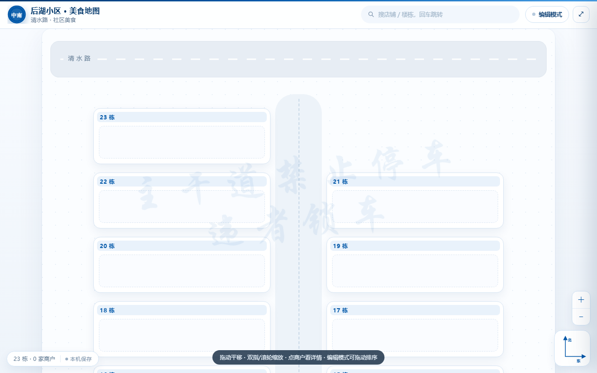
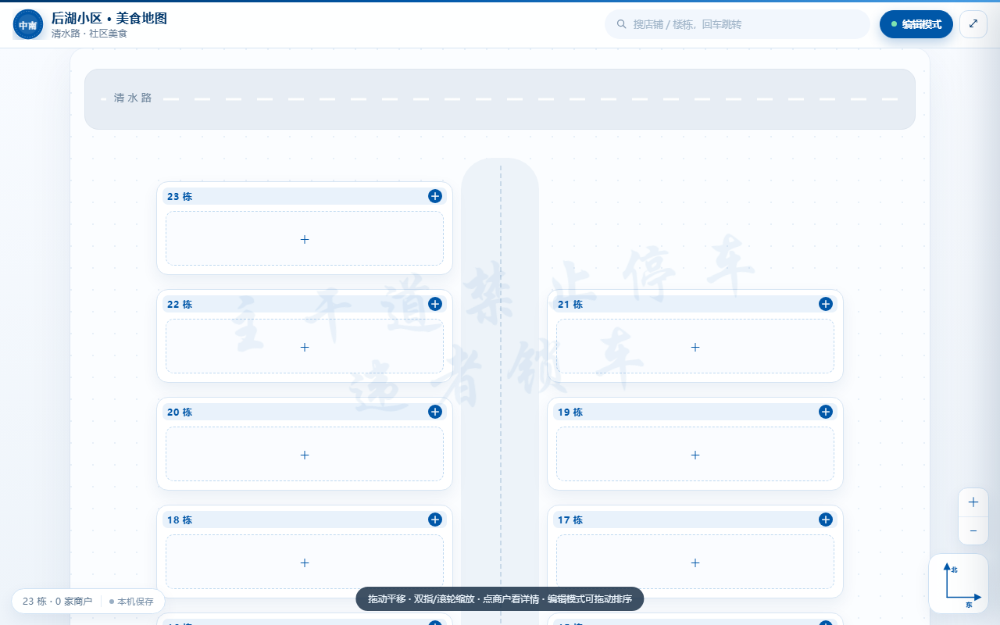

# 使用说明

后湖小区美食地图 —— 按楼栋看店铺，自己往里加内容和照片。

---

## 一、先选一种打开方式

| 你想要的 | 怎么做 |
|---|---|
| 只想自己看看、改改（数据只在这台电脑） | 双击 `index.html` |
| 手机和电脑看到同一份内容 | 在电脑上跑 `node server.js`，两边都打开终端打印的地址 |
| 多人一起维护（站点形式，默认谁都能改） | 用部署版 `server-auth.js`，见 [deploy/README.md](deploy/README.md) |

后两种在左下角会显示 **已同步**（绿点）；第一种显示 **本机保存**（灰点）。

---

## 二、界面导览

| 位置 | 是什么 |
|---|---|
| 左上 | 校徽、标题 |
| 顶部中间 | 搜索框 |
| 右上 | 登录状态 / 编辑模式 / 全览 |
| 中间 | 楼栋地图，北在上、东在右 |
| 左下 | 楼栋数、商户数、保存状态 |
| 右下 | 缩放 + / − 和指北针（固定不动） |

---

## 三、浏览地图

- **移动**：按住空白处拖动
- **缩放**：鼠标滚轮，或手机上双指捏合，或右下角 ＋ / −
- **看全貌**：点右上角 ⤢ 一键铺满
- **看店铺**：点商户小格子，右侧滑出详情

每一栋楼是一个等大的盒子，左上角写着楼栋号，里面的小格子就是这家楼的商户。
格子会自动铺满整栋楼：1 家时占满，2 家各一半，多了自动换行。

---

## 四、搜索

顶部输入框支持三种搜法：

| 输入 | 结果 |
|---|---|
| `茶百道` | 店铺名（前缀匹配优先） |
| `奶茶` | 按分类找 |
| `7` 或 `7栋` | 直接定位 7 栋 |

`↑` `↓` 选择，`回车` 跳转，`Esc` 关闭。选中后地图会平滑推到那栋楼并高亮闪两下，
如果是店铺还会直接打开详情页。

---

## 五、需要登录吗？

**默认不需要。** 打开页面就能直接改，右上角就是「编辑模式」。

如果站点管理员开启了「登录才能编辑」（`REQUIRE_LOGIN=1`），你会看到：

- 未登录时右上角显示「登录后编辑」，没有编辑按钮，详情页标题旁标着「只读」
- 点它可以统一身份认证或本地账号登录，回来即可编辑
- 登录状态保持 7 天，点右上角自己的名字可退出

---

## 六、编辑

### 1. 进入编辑模式

点右上角 **编辑模式**（按钮变蓝）。每栋楼右上角出现 ＋，每个商户出现红色 × 和右下角斜纹。

### 2. 添加商户

点楼栋右上角的 **＋**（或空楼栋中间的大 ＋）→ 自动新建一家「新商户」并打开详情页 →
把名字改成店名，填分类和介绍。

### 3. 写内容

详情页里：

- **名称**：直接点标题改
- **分类**：标题下方的小输入框，如「奶茶」
- **＋ 文字**：加一段文字，写招牌菜、营业时间、人均
- **＋ 图片**：选手机相册里的照片，会自动压到 1000px 再存
- 每段右上角的 × 可以删掉这一段

所有改动**自动保存**，不需要点保存按钮。

### 4. 调整顺序

编辑模式下**按住商户拖到另一个商户的左边或右边**，松手即完成交换。
松手时会提示「顺序已更新」。

### 5. 调整大小

编辑模式下拖商户**右下角的斜纹**，可以把它拉宽或收窄。
同一行的其他商户会自动让位，永远不会出现空隙或重叠。

### 6. 删除

点商户右上角的**红色 ×** → 确认。手机上同样可以点。

---

## 七、多人同时编辑

- 你在改，别人打开页面就能看到最新内容，不用刷新
- 别人改完，你这边会自动更新，并提示「已同步其他设备的修改」
- 不会打断你：**正在详情页打字、或正在拖拽时**，会等你关掉详情页再同步
- 冲突规则：同一时刻两人改同一份，**后保存的覆盖先保存的**（一前一后编辑没问题）

---

## 八、版本回滚与管理后台（可选）

不管开不开放编辑，服务端都会保留**最近 8 次修改**记录（谁改的、什么时候、多少家店）。

如果站点开启了登录，管理员登录后访问 `/admin`：

- **成员权限**：把某人设为「只读 / 可编辑 / 管理员」（改完该用户需重新登录）
- **版本历史**：一键回滚到某个版本

> 页面没有「清空」按钮。确实要清空整张地图，请联系站点管理员在服务器上处理。

---

## 九、常见问题

**Q：为什么我打开是「本机保存」？**
A：说明没用服务打开。用 `file://` 双击打开的页面只能存在本机；要同步请按第一节跑服务。

**Q：手机上改了，电脑看不到？**
A：检查两边左下角是不是都是绿点；不是的话确认连的是同一个服务地址。

**Q：登录后还是不能编辑？**
A：说明站点开了登录，而你的账号是「只读」，让管理员在 `/admin` 改成「可编辑」。

**Q：图传不上去？**
A：单张图会压到 1000px 内；如果还失败，可能是服务端上传大小限制（默认 40MB）或浏览器本地空间满。

**Q：想换个账号？**
A：（仅开启登录的站点）点右上角名字退出，重新登录。

**Q：数据在哪？怎么备份？**
A：部署版在服务器的 `data/` 目录（`map.json` 是地图数据），打包这个目录即可。

---

## 十、操作速查

| 操作 | 电脑 | 手机 |
|---|---|---|
| 移动地图 | 拖空白处 | 单指拖动 |
| 放大缩小 | 滚轮 / ＋− | 双指捏合 / ＋− |
| 看全貌 | ⤢ | ⤢ |
| 搜索 | 顶部输入框 | 顶部输入框 |
| 打开店铺 | 点小格子 | 点小格子 |
| 编辑 | 右上「编辑模式」 | 右上「编辑模式」 |
| 调顺序 | 拖动商户 | 长按拖动 |
| 调大小 | 拖右下角斜纹 | 拖右下角斜纹 |
| 删除 | 红色 × | 红色 × |
